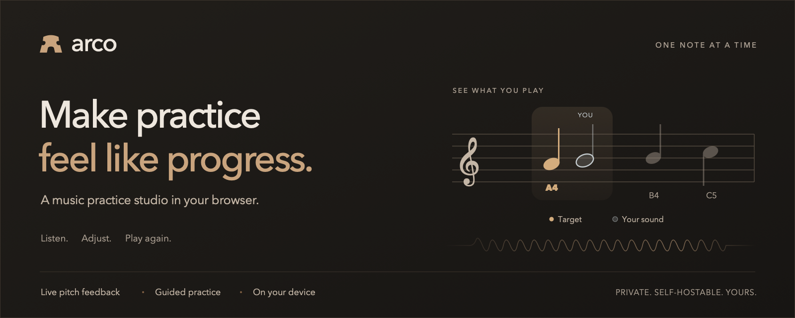

# Arco

**See your sound. Find your pitch. Make every practice count.**

[Try Arco](https://rajmayank.github.io/arco-music/)

Arco is a music practice studio in your browser. Play a note, see it appear on the staff, and follow a small challenge at your own pace. Live feedback, guided exercises, and a calm interface help turn repetition into progress.

The vision is a practice companion across instruments: a shared place to develop your ear, read music, and build confidence, with guidance that fits the instrument in your hands. Broader instrument coverage and richer practice experiences are part of that direction.

Private by design. Frontend-only. Self-hostable. Your sound stays on your device.

## What you can do

- **See what you play.** A translucent live note appears beside your target on the staff, with accidentals, ledger lines, and clear pitch guidance.
- **Practice one note at a time.** Work through scales, familiar melodies, and focused drills. Hold a note steadily to move on automatically.
- **Get in tune.** Use the chromatic tuner, reference tones, and adjustable concert pitch.
- **Find your next note.** Instrument profiles provide clefs, ranges, and suggested string and finger positions.
- **Build a habit.** Short sessions track notes played, notes per minute, and pitch accuracy. Review your history or export it as JSON.
- **Make it yours.** Warm light and dark themes, an optional metronome, keyboard controls, and listening settings that stay out of the way until needed.

No account, API key, backend, or external service is required. The app uses native JavaScript modules, SVG, Canvas, and the Web Audio API, with no package dependencies.

## Run locally

Requires **Node.js 20 or later** for development and build commands.

```sh
git clone https://github.com/rajmayank/arco-music.git
cd arco-music
npm run dev
```

Open [http://127.0.0.1:5173](http://127.0.0.1:5173) in a recent Chrome, Edge, Safari, or Firefox. No `npm install` is needed.

Use the local server rather than opening `index.html` directly: the app uses ES modules, and microphone access needs a secure context. If an embedded browser does not offer microphone permission, open the app in a full browser tab.

## Your first session

1. Open **Settings** and choose your instrument and session length.
2. Visit **Tune**, enable the microphone, and play a single steady note. Use a reference tone if needed.
3. Open **Practice**, choose an exercise, and press **Start practice**.
4. Match the amber note. Your detected pitch appears alongside it. Hold the note steadily and the next target appears automatically.
5. For repeated notes, leave a brief silence between them. Review your session in **Progress** when finished.

To explore without microphone access, choose **Try without a microphone**, select a simulated pitch, and press **Show pitch**. Demo sessions stay separate from practice history.

**Settings → Fine-tune listening** contains pitch tolerance, hold duration, background-noise filtering, reference pitch, microphone input, and detailed readings. Use headphones when playing reference tones or the metronome so the microphone hears your instrument clearly.

| Shortcut | Action |
| --- | --- |
| `Space` | Start or pause practice, when focus is outside a control |
| `H` | Hear the target note |
| `Escape` | Close a dialog |

Opening settings, switching sections, hiding the tab, or playing a reference tone pauses an active session.

## Self-host

The [GitHub Pages site](https://rajmayank.github.io/arco-music/) deploys automatically after changes to `main` pass the `check` job. Pull requests run the same tests, JavaScript checks, and build without publishing. The workflow uploads only `dist/` and uses GitHub's Pages deployment credentials.

```sh
npm test
npm run check
SITE_URL=https://your-domain.example/ npm run build
```

Upload the **contents of `dist/`** to any HTTPS static host. No Node process is needed in production. Relative asset paths support hosting under a subdirectory; include that path in `SITE_URL`.

`SITE_URL` sets the canonical URL and absolute Open Graph and Twitter preview URLs. You can omit it for a local build with `npm run build`. The app's social preview lives in `web/assets/og-image.png`, with editable SVG source beside it.

To inspect the build locally:

```sh
npm run preview
```

Set `PORT=8080` to change the port. The local server binds to loopback by default. `HOST=0.0.0.0` exposes it to your network, but other devices still need HTTPS for microphone access.

Your host must serve `.js` files with a JavaScript content type and allow microphone access. If embedding the app, the parent page must also permit microphone use.

<details>
<summary>Example Nginx configuration</summary>

Place this inside your existing HTTPS server block:

```nginx
root /var/www/arco;
index index.html;
include /etc/nginx/mime.types;

location / {
    try_files $uri $uri/ =404;
    add_header Permissions-Policy "microphone=(self)" always;
    add_header X-Content-Type-Options "nosniff" always;
}
```

</details>

## Privacy and feedback

Microphone samples are analyzed in memory on your device. Arco does not record or upload them and makes no external service requests. Settings and up to 200 completed session summaries live in browser localStorage. Export your history before clearing browser data or moving to a new domain.

Current feedback focuses on **single-note pitch**. Play one note at a time; chords, accompaniment, echo, and noisy input can confuse detection. Notation shows note order rather than scored rhythm. Suggested finger positions are guides, and microphone pitch alone cannot verify finger choice, posture, or playing technique.

Pitch accuracy measures confidently detected playing time that matches the target and tolerance; silence is excluded. Notes per minute counts completed notes over active session time, including silence.

## Contributing

Help shape a practice companion for more instruments. Instrument profiles, exercises, accessible notation, and real-instrument testing are useful places to contribute. [Open an issue](https://github.com/rajmayank/arco-music/issues) to discuss an idea or report a problem. For pitch-detection reports, include your instrument, browser, microphone, and the note you were playing.

```text
web/
  index.html, styles.css, layout.css, theme.css
  assets/          Branding and social preview
  js/
    app.js         Interface, microphone coordination, local history
    audio.js       Web Audio, YIN pitch detection, tones, metronome
    music.js       Instrument profiles, pitch conversions, exercises
    visuals.js     Staff notation and instrument guides
    session.js     Practice timing and note validation
    theme.js       Theme preferences
scripts/
  serve.mjs        Local static server
  build.mjs        Dependency-free static build
tests/             Pitch, notation, music mapping, and session checks
docs/              Repository visuals
```

Run `npm test` and `npm run check` before submitting code changes. Automated checks cover synthetic audio and session behavior; testing with a physical instrument and microphone remains essential.

Changes to `main` require a pull request, a passing `check`, and owner review. The owner may bypass self-review for their own pull requests, but CI remains required.

## License

[Apache License 2.0](LICENSE).
